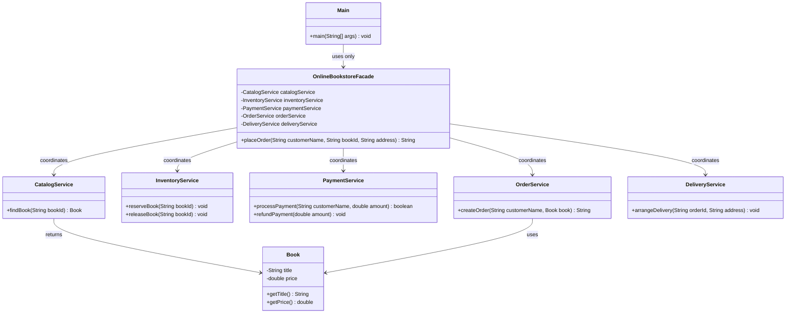

# Online Bookstore — Facade Pattern

**Course:** Software Design Patterns  
**Assignment:** #4 — Facade Pattern  
**Language:** Java  
**Dependencies:** None (standard Java library only)

## 1. Project Overview

This project demonstrates the **Facade structural design pattern** through a simple online bookstore.

To place an order, a client would otherwise need to coordinate several services: find a book, reserve stock, process payment, create an order, and arrange delivery. `OnlineBookstoreFacade` provides one simple public method, `placeOrder()`, and coordinates these steps internally.

## 2. How to Run

Requires JDK 17 or later (JDK 8+ should also work with a compatible compiler).

From the project directory:

```bash
javac src/*.java
java -cp src Main
```

In IntelliJ IDEA:
1. Open the project folder.
2. Make sure a JDK is configured.
3. Open `src/Main.java`.
4. Run `Main`.

## 3. Example Console Output

```text
=== Online Bookstore ===
Catalog: found "Clean Code".
Inventory: one copy reserved.
Payment: received 8500.00 KZT from Alex.
Order: ORD-1001 created for Alex (Clean Code).
Delivery: shipment arranged for ORD-1001 to Astana, Kazakhstan.
Facade: order completed successfully.
Your order number: ORD-1001

=== Try to order an unavailable book ===
Catalog: found "Head First Design Patterns".
Order failed: Book is currently out of stock: head-first-design-patterns
```

The order ID counter starts at `1001`. The unavailable-book example demonstrates error handling.

## 4. UML Structure



## 5. Classes and Responsibilities

| Class | Responsibility |
|---|---|
| `Main` | Client; calls only the facade |
| `OnlineBookstoreFacade` | Provides a simplified API and coordinates the order workflow |
| `CatalogService` | Finds a book by ID |
| `InventoryService` | Checks stock and reserves or releases a copy |
| `PaymentService` | Processes payment and can issue a refund |
| `OrderService` | Creates an order ID and records the order in the console |
| `DeliveryService` | Arranges delivery |
| `Book` | Stores book title and price |

The subsystem classes do not reference the facade. They can still be used independently by advanced clients.

## 6. Order Workflow

1. The client calls `placeOrder(customerName, bookId, address)`.
2. The facade asks the catalog to find the book.
3. The inventory service reserves one copy.
4. The payment service processes the payment.
5. The order service creates an order ID.
6. The delivery service arranges delivery.
7. The facade returns the order ID to the client.

If a runtime failure occurs after inventory reservation, the facade releases the reserved copy. If payment was completed, it also requests a refund. This is a simplified educational example; a real system would need persistent storage and reliable transaction handling.

## 7. Five Clean Code Principles

### 1. Meaningful Names
Names such as `reserveBook()`, `processPayment()`, and `arrangeDelivery()` describe what each method does. The facade method `placeOrder()` communicates the high-level operation.

### 2. Single Responsibility Principle (SRP)
Each subsystem class has one focused responsibility. For example, `CatalogService` searches the catalog, while `PaymentService` handles payment. The facade coordinates these services rather than implementing their internal business logic.

### 3. Encapsulation
The facade's internal service objects are `private`. The client does not need to know how the catalog, inventory, payment, order, or delivery services work.

### 4. Small, Clear Public API
The client calls one method, `placeOrder()`, instead of invoking five subsystem services in the correct order. The facade hides orchestration details.

### 5. Error Handling
The services validate their inputs and report invalid operations with exceptions. The facade attempts to release reserved stock and refund a completed payment when the workflow fails.

## 8. Why This Is the Facade Pattern

- **Facade:** `OnlineBookstoreFacade`
- **Subsystem:** `CatalogService`, `InventoryService`, `PaymentService`, `OrderService`, and `DeliveryService`
- **Client:** `Main`
- **Simplified operation:** `placeOrder()`

The pattern does not eliminate the subsystem classes or make them depend on the facade. It provides a convenient entry point for common tasks while keeping the subsystem usable on its own.

## 9. Defense Questions and Answers

### Q1. What is the Facade pattern?
**Answer:** Facade is a structural design pattern that provides a simple interface to a complex subsystem.

### Q2. What is the facade in this project?
**Answer:** `OnlineBookstoreFacade` is the facade. Its `placeOrder()` method coordinates all the services needed to place an order.

### Q3. Why do we need a facade?
**Answer:** Without it, the client would need to know the correct order for catalog search, stock reservation, payment, order creation, and delivery. The facade hides this complexity.

### Q4. Which classes form the subsystem?
**Answer:** `CatalogService`, `InventoryService`, `PaymentService`, `OrderService`, and `DeliveryService`.

### Q5. Does `Main` call subsystem classes directly?
**Answer:** No. `Main` creates and calls only `OnlineBookstoreFacade`. This satisfies the client requirement.

### Q6. Do subsystem classes know about the facade?
**Answer:** No. They do not have a reference to it. The facade depends on the subsystem, not the other way around.

### Q7. Is the facade the same as the subsystem?
**Answer:** No. The subsystem contains the actual service responsibilities. The facade only coordinates them through a simpler interface.

### Q8. How does this project demonstrate Single Responsibility Principle?
**Answer:** Each service has a focused job, and the facade only coordinates the workflow.

### Q9. What happens if the book is out of stock?
**Answer:** `InventoryService` throws an exception. The facade stops the workflow, and `Main` catches the exception and prints an error message.

### Q10. Is this a real payment or delivery integration?
**Answer:** No. These are simplified service classes that simulate the workflow through console messages. A production system would integrate real payment, inventory, order, and delivery infrastructure.

### Q11. Can an advanced client use a subsystem directly?
**Answer:** Yes. The subsystem classes are independent of the facade and can be used directly when necessary.

### Q12. What is the main benefit of this design?
**Answer:** It reduces coupling between the client and the subsystem by giving the client one simple entry point.

## 10. Limitations

This is an educational in-memory demonstration:
- Book data and stock are reset when the program restarts.
- Payment and delivery are simulated.
- It does not use a database, web server, or real external services.
- Production-grade transactions would require stronger consistency and recovery mechanisms.
